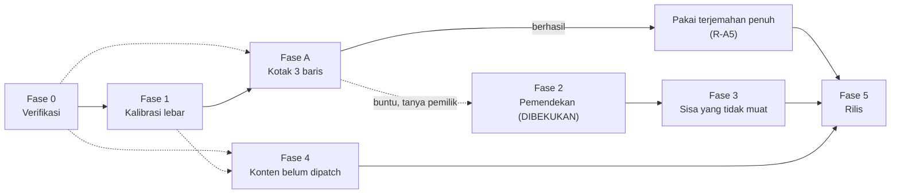

# Haganai Portable: Patch Teks Inggris

by: KangJiho · Terakhir diperbarui: 2026-10-19

Proyek menerjemahkan **Boku wa Tomodachi ga Sukunai Portable (PSP, ULJS00459)** ke bahasa Inggris dengan mengedit `RES.DAT` langsung.

> Dokumen ini **menggantikan** README ringkas dan README lengkap sebelumnya. Isinya gabungan keduanya: status, **roadmap**, panduan kerja, temuan engine, dan data mentah file asli, disusun dari yang paling sering dibaca ke yang paling jarang.

> **ARAH PROYEK (keputusan pemilik, 2026-10-19; baca ini dulu):** pemilik proyek **tidak mau lanjut memotong atau memendekkan terjemahan** batch demi batch, karena maknanya jadi berkorban dibanding arti Jepang aslinya. Targetnya sekarang: **membuat kotak teks muat 3 baris** (geser teks naik dan/atau kecilkan font), lalu memakai lagi terjemahan penuh dari `haganai_dialogue_EN_v2.csv` dan `haganai_remaining_EN_full_v2.csv`. Pemendekan (batch 17 dan seterusnya) **dibekukan**: jangan menulis batch pemendekan baru kecuali pemilik memintanya lagi. Langkah kerjanya ada di [Fase A](#33b-fase-a-kotak-3-baris-prioritas-utama-sejak-2026-10-19).

## Daftar isi

1. [Gambaran proyek](#1-gambaran-proyek)
2. [Status sekarang](#2-status-sekarang)
3. [Roadmap](#3-roadmap)
4. [Folder, skrip, dan data](#4-folder-skrip-dan-data)
5. [Cara menjalankan](#5-cara-menjalankan)
6. [Aturan kerja](#6-aturan-kerja)
7. [Temuan tentang engine game](#7-temuan-tentang-engine-game)
8. [Format data game](#8-format-data-game)
9. [Opsi untuk teks > 2 baris](#9-opsi-untuk-teks--2-baris)
10. [Gerbang sebelum build dianggap beres](#10-gerbang-sebelum-build-dianggap-beres)
11. [Jebakan dan pelajaran](#11-jebakan-dan-pelajaran)
12. [Riwayat](#12-riwayat)
13. [Lampiran: pencocokan klaim dengan data asli](#13-lampiran-pencocokan-klaim-dengan-data-asli)

Bagian baru: [7.7 Hasil bongkar envpsp.dat](#77-hasil-bongkar-envpspdat-2026-10-19)

---

## 1. Gambaran proyek

### Alur kerja

```
extract.py            CSV terjemahan (kolom english_text)
  RES.DAT asli  --->  FULL_dialogue_wrap_fixed.csv + FULL_remaining_wrap_fixed.csv
                                 |
                                 v   pipeline.py   (wrap + padding otomatis)
                       RES_patched_vN.DAT
                                 |
                                 v   seekmap_rebuild.py   (first.dat asli sebagai dasar)
                       first_new_vN.dat
                                 |
                                 v
                       Tes di PPSSPP (pasangan RES + first.dat harus dari build yang sama)
```

1. Teks Jepang diekstrak ke CSV (satu baris = satu dialog, narasi, atau pilihan).
2. Terjemahan Inggris ditulis di kolom `english_text`.
3. `pipeline.py` menyuntikkan teks Inggris ke `RES.DAT` (wrap dan padding otomatis).
4. `seekmap_rebuild.py` membuat `first.dat` yang cocok dengan `RES.DAT` baru.
5. Tes di PPSSPP.

### Masalah utama

**Kotak teks hanya muat 2 baris.** Terjemahan Inggris sering jadi 3 atau 4 baris sehingga baris ke-3 terpotong. Cara lama: **memendekkan terjemahan batch demi batch** (`fixes_batchN.csv`, 1.429 baris; **dibekukan 2026-10-19**). Cara yang dituju sekarang: **membuat kotak muat 3 baris** lewat geser teks naik dan mengecilkan font ([Fase A](#33b-fase-a-kotak-3-baris-prioritas-utama-sejak-2026-10-19), [7.6](#76-hasil-bongkar-eboot-2026-10-19)). Pecah dialog jadi dua kotak ([bagian 9](#9-opsi-untuk-teks--2-baris)) jadi cadangan.

### Folder kerja

| Folder | Isi |
|---|---|
| `D:\Reverse engginering\project haganai\scripts tools` | semua skrip `.py` dan CSV kerja. **Semua perintah dijalankan dari sini** |
| `D:\Reverse engginering\project haganai\script_output\translate dialogue` | CSV sumber terjemahan |
| `D:\Reverse engginering\project haganai\data ekstrak` | game asli: `RES.DAT`, `first.dat`, `EBOOT.BIN` |

---

## 2. Status sekarang

| Bidang | Status |
|---|---|
| **Arah proyek** | **Pemendekan dibekukan.** Target: kotak muat 3 baris (geser teks + kecilkan font), lalu pakai terjemahan penuh |
| **Bongkar EBOOT (2026-10-19)** | Ukuran teks (skala float) diteruskan ke fungsi penggambar string dan nilainya dibaca dari data biner saat boot. Belum diketahui pemanggil mana yang menggambar kotak dialog dan di file data mana nilainya ([7.6](#76-hasil-bongkar-eboot-2026-10-19)) |
| Dialog dan narasi > 2 baris | **5.341 tersisa** (dialog 3.359, narasi 1.982), diukur dengan lebar ketat 35/37 |
| Tambalan pemendekan | **1.429 baris** diterapkan (batch 16 terakhir, 2026-10-17) |
| Choice (pilihan) | **Selesai.** 365 baris, 0 kosong, 0 > 38 kolom; batas sementara 22 kolom |
| Scene title (673) dan banter (610) | Tidak dipatch, tetap Jepang (format belum di-reverse) |
| Build v12 | Sudah dibuat (15.698/15.698 baris cocok). **Tes game belum dilaporkan** |
| Build v13 | **Belum jalan**, karena `pipeline.py` di folder masih versi lama (tanpa `--width2`) |
| envpsp.dat (2026-10-19) | Format stream terbaca, 2 kandidat skala (0,8, posisi atas layar, bukan dialog); belum terbukti ([7.7](#77-hasil-bongkar-envpspdat-2026-10-19)) |
| Teori aturan lebar karakter | Ditemukan di kode EBOOT, **belum dibuktikan di game** |
| Perapian skrip | Selesai, tapi belum diuji pada data asli |
| Data file asli (`RES.DAT`, `first.dat`) | Sudah dianalisis dan diverifikasi ([bagian 8](#8-format-data-game)) |

**Penghalang terbesar:** (1) belum ada patch yang membuat kotak muat 3 baris, dan (2) aturan lebar kolom belum terbukti di game, jadi angka sisa 5.341 (diukur untuk 2 baris) belum bisa dipercaya. Roadmap di bawah mengerjakan keduanya, dan **tidak menulis batch pemendekan baru**.

---

## 3. Roadmap

### 3.1 Peta fase



Garis putus-putus berarti **bisa dikerjakan paralel** atau hanya dipakai sebagai cadangan. Fase A tidak bergantung pada hasil Fase 1, tapi lebar baris akhirnya perlu dikalibrasi ulang setelah ukuran font diubah. Fase 4 sebagian besar tidak bergantung pada metrik lebar (reverse scene title dan banter), kecuali batas panjang choice yang butuh hasil Fase 1.

| Fase | Tujuan | Selesai bila |
|---|---|---|
| 0. Verifikasi | Pastikan fondasi benar sebelum menulis lebih banyak | v12 dites, `pipeline.py` versi `--width2` terpasang, skrip hasil perapian lolos |
| 1. Kalibrasi lebar | Tetapkan satu cara menghitung lebar baris yang terbukti di game | Lebar standar baru tercatat di bagian 6 dan `csv_tools.py` sama dengan `pipeline.py` |
| **A. Kotak 3 baris (prioritas)** | Buat kotak dialog dan narasi muat 3 baris, lalu pakai terjemahan penuh | Tes di game: 3 baris terbaca penuh, terjemahan penuh dipakai |
| 2. Pemendekan massal (**dibekukan**) | Cadangan bila Fase A buntu | Hanya dilanjutkan bila pemilik proyek memintanya lagi |
| 3. Sisa yang tidak muat | Tangani teks yang kalau dipotong kehilangan makna | Keputusan strategi diambil dan diterapkan |
| 4. Konten belum dipatch | Scene title, banter, batas choice, karakter berisiko | Tiap item punya keputusan: dipatch atau sengaja dibiarkan Jepang |
| 5. Rilis | Build final yang lolos semua gerbang | Semua kotak di [bagian 10](#10-gerbang-sebelum-build-dianggap-beres) tercentang |

### 3.2 Fase 0: Verifikasi

Urut dari yang paling murah.

- [ ] **R0.1 Pasang `pipeline.py` versi `--width2`.** Cek dengan `findstr /C:"--width2" pipeline.py` (harus ada keluaran). File hasil unduhan harus menimpa file lama di `scripts tools` (pilih Replace), bukan `pipeline (1).py`. *Kenapa:* tanpa ini build v13 hanya mencetak teks bantuan, lalu `seekmap_rebuild.py` gagal `FileNotFoundError`.
- [ ] **R0.2 Tes build v12 di PPSSPP.** Game baru, tanpa save state. Kalimat uji:
  - "Southern islands vary, but picture an eternal summer paradise."
  - "The odd-eyed blonde is Hasegawa Kobato, my sister. I’m Kodaka."
  - "Don’t get carried away, brat, or no more potato chips."

  Cek empat hal: huruf nyelip, kata terbelah, baris ke-3, baris kedua menjorok. *Kenapa:* memastikan masalah huruf nyelip masih terjadi di build terbaru.
- [ ] **R0.3 Periksa `skip_v12.csv`.** Dari 37 baris skip, 27 baris "ada english_text kosong" seharusnya sudah hilang karena `fill-todo` dijalankan. Sisa 10 baris `0000Index` aman diabaikan.
- [ ] **R0.4 Uji skrip hasil perapian pada data asli.** `python tests.py identity RES.DAT`, `python dump.py opcodes RES.DAT` (bandingkan dengan `jumpscan.txt` lama), dan `csv_tools.py short`. Parser seekmap bersama lebih ketat: baris tak dikenali sekarang menghentikan skrip dengan error.

**Keluar dari fase ini bila:** R0.1 sampai R0.4 selesai dan hasil R0.2 dicatat.

### 3.3 Fase 1: Kalibrasi lebar

Tujuan: berhenti menebak lebar kolom. Semua angka sisa overflow bergantung pada ini.

- [ ] **R1.1 Tes `ruler2`** untuk membuktikan atau menggugurkan teori dua kelas lebar ([7.3](#73-aturan-lebar-karakter-di-kode-eboot-belum-dibuktikan-di-game)).
  ```
  python calibrate.py ruler2 FULL_dialogue_wrap_fixed.csv dlg_ruler2.csv
  python pipeline.py RES.DAT dlg_ruler2.csv FULL_remaining_wrap_fixed.csv RES_ruler2.DAT --width 0
  python seekmap_rebuild.py build RES_ruler2.DAT first.dat first_ruler2.dat
  ```
  Prediksi bila teori benar: baris uji `.`, `’`, `…` patah di angka sekitar **24 sampai 25**; baris `i` patah di sekitar **39**. Hasil yang jauh dari itu berarti teori salah.
- [ ] **R1.2 Build dan tes v13** (`--width 36 --width2 38 --nwidth 38`, perintah di [5.2](#52-build)). Cek ulang empat hal yang sama dengan R0.2.
- [ ] **R1.3 Samakan `csv_tools.py` dengan `pipeline.py`.** Beri opsi lebar baris 2+ (dan metrik 7/10 bila R1.1 cocok). Tanpa ini hitungan sisa jadi terlalu besar.
- [ ] **R1.4 Hitung ulang sisa overflow** dengan `csv_tools.py fix` memakai lebar yang baru. Catat sebagai baseline baru di [12.1](#121-teks--2-baris-overflow).
- [ ] **R1.5 Tetapkan lebar standar** dan perbarui tabel di [bagian 6](#6-aturan-kerja).

**Aturan keputusan:**

| Hasil | Tindakan |
|---|---|
| R1.1 cocok (24 sampai 25 dan 39) | Ganti `cw`, `wrap_lines`, `wrap_pad` di `pipeline.py` dan hitungan lebar di `csv_tools.py` ke metrik 7/10 (huruf, angka, spasi, `:` = 7; lainnya = 10; kapasitas sekitar 39 x 7). Hitung ulang sisa |
| R1.1 tidak cocok | Buang teori; pakai hasil v13 apa adanya |
| v13 lolos | Jadikan 36/38/38 standar baru |
| v13 muncul kata terbelah | Fallback `--width 35 --width2 37 --nwidth 37` |
| Apostrof bermasalah | Coba `--apos-w 1` atau `--apos-w 2` |
| Baris kedua masih menjorok | Selidiki spasi pad yang melewati kapasitas ([7.1](#71-hasil-kalibrasi-ppsspp-v1204-scene-0011ess0)) |

**Keluar dari fase ini bila:** ada satu set lebar yang lolos tes di game dan kedua alat menghitungnya sama.

### 3.3b Fase A: Kotak 3 baris (prioritas utama sejak 2026-10-19)

**Alasan:** pemilik proyek tidak mau memotong terjemahan lagi karena maknanya berkorban terhadap arti Jepang aslinya. Di screenshot tes, baris ke-3 hanya terpotong separuh di tepi bawah layar, jadi menggeser teks naik sekitar 12 sampai 14 px dan/atau mengecilkan font kemungkinan cukup (perkiraan kasar dari screenshot jendela non-16:9, belum diukur). Tiga baris memberi ruang sekitar 50% lebih banyak dari dua baris, dan font yang lebih kecil juga menambah jumlah huruf per baris.

**Dasar teknis:** fungsi penggambar string menerima skala horizontal dan vertikal sebagai argumen float, dan nilai skala serta posisi dibaca dari data biner saat game mulai ([7.6](#76-hasil-bongkar-eboot-2026-10-19)). Artinya ukuran teks adalah angka yang bisa diubah, bukan batas keras engine.

- [~] **R-A1 (sebagian selesai 2026-10-19: file sudah ada, kandidat di [7.7](#77-hasil-bongkar-envpspdat-2026-10-19), pemetaan belum terbukti)** Ambil `envpsp.dat` dari ISO** (7-Zip, `PSP_GAME\USRDIR`) dan upload ke chat. Cocokkan dengan tanda tangan urutan baca di 7.6 untuk menemukan float skala dan nilai posisi di sekitarnya. Tanpa file ini nilai yang tersimpan tidak bisa dibaca.
- [ ] **R-A2 (belum; lihat 7.7)** Tentukan pemanggil yang menggambar kotak dialog dan narasi.** Ada 4 pemanggil fungsi penggambar string; kotak dialog mungkin memakai jalur lain. Cara: ubah satu nilai per tes lalu lihat apa yang berubah di PPSSPP, atau pakai debugger PPSSPP (menu Debug) dengan breakpoint di fungsi penggambar string (alamat saat jalan beda dari alamat di file karena ada basis modul).
- [ ] **R-A3 Eksperimen, satu perubahan per tes:** (a) kecilkan skala, (b) geser posisi Y naik, (c) gabungan. Catat nilai awal sebelum mengubah. Cek keterbacaan font di ukuran kecil dan pastikan baris ke-3 tidak menabrak tepi atas kotak.
- [ ] **R-A4 Putuskan cara patch:** ubah nilai di file data (`envpsp.dat` bila terbukti) atau patch instruksi di EBOOT terdekripsi. PPSSPP umumnya bisa menjalankan EBOOT terdekripsi di folder hasil extract; perlu dites.
- [ ] **R-A5 Setelah 3 baris terbukti di game, pakai lagi terjemahan penuh.** Sumber penuh: `haganai_dialogue_EN_v2.csv` dan `haganai_remaining_EN_full_v2.csv` (belum di-wrap), atau cadangan `FULL_*_wrap.csv` (cek dulu apakah masih memuat teks sebelum pemendekan). `FULL_*_fixed.csv` sekarang berisi teks yang sudah dipendekkan 1.429 baris; **jangan dihapus**, simpan `fixes_batch*.csv` sebagai catatan.
- [ ] **R-A6 Samakan alat:** `pipeline.py` dan `csv_tools.py` ke `--max-lines 3` dan lebar baru sesuai skala font, lalu hitung berapa teks penuh yang masih > 3 baris.

**Keluar dari fase ini bila:** 3 baris terbukti terbaca di game dan terjemahan penuh sudah dibuild.

**Aturan keputusan:** bila semua jalur Fase A buntu, **tanya pemilik proyek dulu** sebelum kembali memotong teks. Jalur cadangan lain: pecah dialog jadi dua kotak ([9.2](#92-pecah-dialog-jadi-dua-kotak)).

### 3.4 Fase 2: Pemendekan massal (DIBEKUKAN)

**Status: dibekukan sejak 2026-10-19.** Pemilik proyek tidak mau lanjut memotong terjemahan. Bagian ini disimpan sebagai cadangan, bukan rencana aktif. Dulunya dikerjakan batch demi batch.

- [ ] **R2.1 Loop per batch:** buat worklist baru, tulis batch, terapkan, pastikan `ditolak: 0 | tidak ketemu: 0` ([5.1](#51-memendekkan-dialog-dan-narasi)).
- [ ] **R2.2 Prioritas scene yang paling sering dimainkan**, baris dengan `cut` terbesar lebih dulu.
- [ ] **R2.3 Laju:** 100 baris per batch; naik ke 200 bila tes game (R0.2 atau R1.2) lolos.
- [ ] **R2.4 Backup berkala:** salin `FULL_*_fixed.csv` ke folder lain dan simpan semua `fixes_batch*.csv`.
- [ ] **R2.5 Build uji berkala** supaya masalah tampilan ketahuan lebih awal, bukan di akhir.

Beban kerja pada baseline sekarang (5.341, akan berubah setelah Fase 1):

| Laju | Perkiraan jumlah batch |
|---|---|
| 100 per batch | sekitar 54 |
| 200 per batch | sekitar 27 |

Titik pantau (angka sisa total; ganti dengan baseline baru dari R1.4):

| Milestone | Sisa |
|---|---|
| M2.0 (sekarang) | 5.341 |
| M2.1 | sekitar 4.000 |
| M2.2 | sekitar 2.500 |
| M2.3 | sekitar 1.000 |
| M2.4 | 0 atau hanya sisa ber-`cut` besar yang diputuskan di Fase 3 |

**Keluar dari fase ini bila:** dialog dan narasi > 2 baris = 0, atau sisanya hanya teks yang sengaja diserahkan ke Fase 3.

### 3.5 Fase 3: Sisa yang tidak muat

Dimulai ketika yang tersisa adalah teks yang kalau dipotong kehilangan makna penting (kolom `cut` besar). Rekomendasi sementara: **hybrid** (pendekkan yang bisa, perlakukan khusus yang tidak bisa).

- [ ] **R3.1 Putuskan jalur** untuk sisa teks. Opsi ada di [bagian 9](#9-opsi-untuk-teks--2-baris).
- [ ] **R3.2 Jalur geser teks naik (12 sampai 14 px).** Terblokir: posisi Y belum ketemu. Langkah: petakan urutan pembacaan stream di loader `0x2c2024`, atau ubah rekaman `envpsp.dat` satu per satu di PPSSPP. Ukuran font juga belum diselidiki.
- [ ] **R3.3 Jalur pecah dialog jadi dua kotak.** Terblokir: opcode goto belum teridentifikasi. Langkah: buat `jumpscan2` sebagai **subcommand `dump.py`** (bukan file lepas), jalankan, kirim `jumpscan2.txt`; bila satu opcode mendominasi, itu goto dan operandnya bisa dipetakan. Lalu tes satu atau dua dialog sebelum dipakai massal dan periksa empat risiko di [9.2](#92-pecah-dialog-jadi-dua-kotak).
- [ ] **R3.4 Terapkan jalur terpilih** hanya pada teks yang butuh, bukan massal.

**Aturan keputusan:** bila kedua jalur masih terblokir saat Fase 2 selesai, sisa teks tetap dipendekkan dan dicatat sebagai kompromi.

### 3.6 Fase 4: Konten yang belum dipatch

Boleh paralel dengan Fase 2.

- [ ] **R4.1 Batas panjang choice** (22, 30, atau 38 kolom) lewat screenshot. Tes awal: 22 kolom muat; yang lebih panjang keluar dari gelembung tapi terbaca. Butuh hasil Fase 1 bila lebar standar berubah.
- [ ] **R4.2 Scene title (673 baris)**: reverse format opcode 700 atau biarkan Jepang. Catatan: op700 ada 674; kemungkinan `0000Index` ("INDEX") tidak diekstrak.
- [ ] **R4.3 Banter (610 baris)**: reverse format opcode 1012/1013/1014 (445/245/210 instruksi) atau biarkan Jepang.
- [ ] **R4.4 Karakter berisiko ♠**: `é`, `①`, `…`, `π` (sekitar 17 baris) diganti ekuivalen aman.
- [ ] **R4.5 Hal terbuka dari analisis data:** selisih 22 baris dialog (21.096 vs 21.074), 19 instruksi choice yang belum terurai, algoritma checksum seekmap dan apakah game memeriksanya ([8.9](#89-yang-belum-diketahui)).

**Keluar dari fase ini bila:** tiap item punya keputusan tertulis.

### 3.7 Fase 5: Rilis

- [ ] **R5.1** Semua kotak di [bagian 10](#10-gerbang-sebelum-build-dianggap-beres) tercentang.
- [ ] **R5.2** Screenshot PPSSPP 3 sampai 5 sampel terparah: tidak terpotong, tidak ada kata terbelah.
- [ ] **R5.3** Build final; `first.dat` di-rebuild dan dipasang sepasang dengan `RES.DAT` dari build yang sama.
- [ ] **R5.4** Catat nama build dan MD5 pasangan final; simpan sebagai acuan.
- [ ] **R5.5** Arsipkan file tes dan build lama ([4.5](#45-yang-boleh-diarsipkan)); pertahankan pasangan final dan semua CSV kerja.

### 3.8 Ringkasan langkah terdekat

1. **R-A1:** ambil `envpsp.dat` dari ISO dengan 7-Zip dan upload ke chat
2. R0.1 pasang `pipeline.py` `--width2` (bisa paralel)
3. R0.2 tes v12 di PPSSPP (bisa paralel)
4. R-A2 sampai R-A4: cari pemanggil kotak dialog, eksperimen skala dan posisi, pilih cara patch
5. R1.1 tes ruler2 dan R1.2 build v13, lalu R1.3 sampai R1.5
6. R-A5 dan R-A6: build dengan terjemahan penuh dan `--max-lines 3`

**Tidak ada batch pemendekan baru** sampai Fase A selesai atau pemilik meminta lagi.

---

## 4. Folder, skrip, dan data

### 4.1 Skrip

| File | Fungsi | Perintah / subcommand |
|---|---|---|
| `pipeline.py` | **Membangun `RES.DAT` baru**: memasukkan teks Inggris ke script game, wrap dan padding otomatis. File yang gagal parse atau verify **tidak dipatch** (Jepang asli utuh), alasannya masuk laporan skip | `python pipeline.py RES.DAT dialogue.csv remaining.csv OUT.DAT [opsi]`. Opsi: `--max-lines`, `--width`, `--width2`, `--nwidth`, `--report`, `--apos-w` |
| `seekmap_rebuild.py` | **Membuat `first.dat` baru** yang cocok dengan `RES.DAT` hasil build. Berisi `parse_seekmap`, parser tunggal yang juga dipakai `dump.py` dan `extract.py` | `python seekmap_rebuild.py build RES.DAT first.dat first_new.dat` |
| `csv_tools.py` | **Alat kerja CSV**: menghitung teks > 2 baris, membuat daftar kerja, menerapkan batch pemendekan, mengurus choice | `fix`, `short`, `choice-fixes`, `choice-short`, `choice-gaps`, `choice-missing`, `fill-todo`, `long-choices`, `encoding`, `verify-length` |
| `dump.py` | **Membongkar isi game** untuk analisis: struktur, instruksi, byte, teks, daftar opcode | `obj`, `inst`, `hex`, `tree`, `entry`, `scan`, `find`, `text`, `gpda-entry`, `seekmap-pos`, `opcodes` (dulu `jumpscan.py`) |
| `calibrate.py` | **Membuat build uji** untuk mengukur lebar baris, apostrof, dan tinggi kotak di PPSSPP | `ruler`, `ruler2`, `apos`, `apos-test`, `lines` |
| `tests.py` | **Tes keamanan** supaya build tidak merusak data | `identity`, `crosscheck`, `seekmap` |
| `extract.py` | **Ekstraksi awal** teks dari `RES.DAT` ke CSV dan cek dialog | `python extract.py ...` |
| `jumpscan2.py` | Rencana: mencari opcode lompat (goto) lewat instruksi tepat sebelum awal cabang pilihan; menulis `jumpscan2.txt`. **Tidak ada di unggahan, belum dijalankan.** Kalau dibuat ulang, jadikan subcommand `dump.py` | n/a |

Skrip lepas buatan Claude (`apply_short.py`, `fill_todo.py`, `choice_gaps.py`, `shorten_pass.py`, `make_choice_fixes.py`) fungsinya sudah tercakup `csv_tools.py`; boleh diarsipkan.

Subcommand `csv_tools.py` yang dipakai rutin:

| Subcommand | Fungsi |
|---|---|
| `fix` | Menghitung teks > 2 baris, membuat daftar kerja (`--worklist`), atau **menerapkan** file `fixes_batchN.csv` ke CSV utama |
| `fill-todo` | Menggabungkan terjemahan choice yang tadinya kosong |
| `choice-fixes` | Menerapkan pendekan choice |
| `long-choices` | Mendaftar choice yang terlalu panjang |

(Fungsi subcommand lain belum dicatat rinci; lihat `--help`.)

### 4.2 CSV utama

| File | Isi |
|---|---|
| `FULL_dialogue_wrap_fixed.csv` | 15.257 baris dialog ber-speaker |
| `FULL_remaining_wrap_fixed.csv` | 7.465 baris: narasi 5.817, scene title 673, banter 610, choice 365 |
| `FULL_dialogue_wrap.csv`, `FULL_remaining_wrap.csv`, `FULL_remaining_short.csv` | versi sebelum `fixed` (cadangan) |
| `haganai_dialogue_EN_v2.csv`, `haganai_remaining_EN_full_v2.csv` | CSV sumber terjemahan (belum di-wrap, tanpa `\n`) |

### 4.3 Tambalan pemendekan (`fixes_*.csv`)

Semua sudah diterapkan. Total **1.429 baris**.

| File | Baris | Catatan |
|---|---|---|
| `fixes_2baris_0011ess0.csv`, `fixes_batch01.csv`, `fixes_batch1.csv` | 24, 51, 24 | batch awal |
| `fixes_batch2.csv`, `fixes_batch4_narasi.csv` | 100, 100 | |
| `fixes_batch5.csv`, `fixes_batch6.csv`, `fixes_batch7.csv` | 40, 60, 80 | |
| `fixes_batch8.csv` | 100 | sisa 5.453 |
| `fixes_batch9.csv` | 150 | sisa 5.303 |
| `fixes_batch10.csv`, `fixes_batch11.csv` | 100, 100 | sisa 5.203 dan 5.103 (lebar bawaan) |
| `fixes_batch12.csv` | 100 | pindah ke lebar ketat 35/37, sisa 5.741 |
| `fixes_batch13.csv` sampai `fixes_batch15.csv` | 100 masing-masing | sisa 5.641, 5.541, 5.441 |
| `fixes_batch16.csv` | 100 | **diterapkan 2026-10-17**: `diterapkan: 100 \| ditolak: 0 \| tidak ketemu: 0`, sisa 5.341 |

- Kolom batch 10 ke atas: `type,scene,ref,speaker,jp,english_new,lines,cut`. Format batch lama berbeda: `batch01` = `sumber,scene,id,english_text`; `batch1` sampai `batch7` = `type,scene,ref,english_new`.
- Batch 10 sampai 12 ditulis dari `next_all.csv` (baris terparah dulu, `cut` terbesar). Batch 13 sampai 16 dari worklist yang dibuat ulang tiap kali dengan lebar ketat. Semua sudah diperiksa muat 2 baris, memakai `’`, dan batch 13 sampai 16 juga lolos terhadap lebar build v13 (dialog 36/38, narasi 38): 400 baris, tanpa apostrof ASCII atau kutip yatim.
- `next_all.csv` lama (5.453 baris, dibuat setelah batch 8) sudah usang; buat ulang tiap batch ([5.1](#51-memendekkan-dialog-dan-narasi)).

### 4.4 Choice dan hasil build

**Choice** (semua sudah diterapkan, lihat [5.3](#53-choice-sudah-dijalankan-2026-10-16-disimpan-sebagai-catatan)):

| File | Baris | Keterangan |
|---|---|---|
| `choice_full.csv` | 818 | semua entri choice 37 instruksi yang di-skip (kolom `status`) |
| `choice_todo.csv` | 29 | choice yang `english_text`-nya kosong |
| `choice_todo_terisi.csv` | 29 | terjemahannya; **sudah digabung** (`fill-todo`: 29 terisi, 0 tidak cocok) |
| `choice_fixes (1).csv` | 209 | usulan pendek (maks 22 kolom); **sudah diterapkan** (209/209) |
| `choice_fixes_todo.csv` | 20 | pendekan dari `choice_todo_terisi`; **sudah diterapkan** (20/20) |
| `choice_long.csv`, `choice_pendek.csv`, `choice_unik.csv`, `choice_terlalu_panjang.csv` | | daftar kerja lama |

**Hasil build dan laporan:**

| File | Fungsi |
|---|---|
| `RES_patched_vN.DAT` | hasil build `pipeline.py` |
| `first_new_vN.dat` | `first.dat` hasil `seekmap_rebuild.py`. **Selalu satu pasang dengan `RES_patched_vN.DAT`** |
| `skip_vN.csv` | laporan baris yang tidak dipatch |
| `dump_choice.txt`, `dump_fail.txt`, `dump_scene.txt` | dump byte instruksi choice (opcode 103) |
| `index_preview.txt` | isi `0000Index`; entri terakhir inst#110 = 戻る/Back, sisanya nama scene seperti `0048ess2`, `_omake_kob` |
| `jumpscan.txt` | daftar opcode (keluaran lama) |
| `dlg_ruler*.csv`, `rem_ruler.csv`, `dlg_lines.csv`, `rem_lines.csv`, `dlg_2baris.csv`, `rem_2baris.csv`, `TEST_*_0011ess0.csv`, `skip_ruler.csv`, `skip_test.csv` | hasil tes kalibrasi (boleh diarsipkan) |

**Laporan skip terbaru: 37 baris**, dua penyebab:

| Alasan | Jumlah | Artinya |
|---|---|---|
| `jumlah pilihan beda` | 10 | semua `0000Index` inst#101 sampai 110. Menu pemilih scene (debug), isinya nama scene. **Aman diabaikan** |
| `ada english_text kosong` | 27 | seharusnya sudah hilang karena `fill-todo` dijalankan; `skip_v12.csv` belum diperiksa |

### 4.5 Yang boleh diarsipkan

Pindahkan ke folder `arsip` dulu, hapus setelah v13 dites.

| Kategori | File |
|---|---|
| Sisa tes | `fixed_0011ess0.obj`, `new_0011ess0.obj`, `patched_0011ess0.obj` (`orig_0011ess0.obj` simpan hanya bila `tests.py crosscheck` mau dijalankan) |
| Hasil kalibrasi | `TEST_*_0011ess0.csv`, `dlg_ruler*.csv`, `rem_ruler.csv`, `dlg_lines.csv`, `rem_lines.csv`, `dlg_2baris.csv`, `rem_2baris.csv`, `skip_ruler.csv`, `skip_test.csv`, `first_ruler*.dat`, `first_lines.dat`, `RES_lines.DAT` |
| Build lama | `RES_patched_v3` sampai `v11`, `first_new_v3` sampai `v11` (+ `first_v5.dat`, `first_v5b.dat`, `*_test.*`). **Simpan pasangan v12** sampai v13 dites |
| Backup CSV | `FULL_*_fixed.csv.bak` dan salinan ber-timestamp (`.2026101x_...`): simpan yang terbaru saja |
| **Jangan dihapus** | `FULL_*_fixed.csv`, `fixes_batch*.csv`, `choice_*.csv` berstatus diterapkan, `index_preview.txt`, `jumpscan.txt` |

---

## 5. Cara menjalankan

Semua dari folder `scripts tools`:

```
cd "D:\Reverse engginering\project haganai\scripts tools"
```

### 5.1 Memendekkan dialog dan narasi

```
python csv_tools.py fix --worklist next_all.csv --limit 0 --max-lines 2 --width 35 --nwidth 37 FULL_dialogue_wrap_fixed.csv FULL_remaining_wrap_fixed.csv
python csv_tools.py fix --max-lines 2 --width 35 --nwidth 37 fixes_batchN.csv FULL_dialogue_wrap_fixed.csv FULL_remaining_wrap_fixed.csv
```

- Baris pertama membuat daftar kerja baru; baris kedua menerapkan batch.
- Yang kedua harus menghasilkan `ditolak: 0 | tidak ketemu: 0`.
- Terapkan batch **berurutan** dan **jangan dua kali**.
- **Selalu sertakan `--width 35 --nwidth 37`** (sampai Fase 1 menetapkan lebar baru). Tanpa itu `fix` memakai bawaan 37/39 dan angkanya lebih kecil (menyesatkan).
- Bila build v13 dipakai (dialog baris 2+ = 38), hitungan `fix` akan **terlalu besar** sampai `csv_tools.py` diberi opsi lebar baris 2+ (R1.3).

### 5.2 Build

**Build v12** (sudah dibuat):

```
python pipeline.py "D:\Reverse engginering\project haganai\data ekstrak\RES.DAT" FULL_dialogue_wrap_fixed.csv FULL_remaining_wrap_fixed.csv RES_patched_v12.DAT --max-lines 2 --width 35 --nwidth 37 --report skip_v12.csv
python seekmap_rebuild.py build RES_patched_v12.DAT "D:\Reverse engginering\project haganai\data ekstrak\first.dat" first_new_v12.dat
```

**Build v13** (hanya setelah `pipeline.py` versi `--width2` terpasang; cek dengan `findstr /C:"--width2" pipeline.py`):

```
python pipeline.py "D:\Reverse engginering\project haganai\data ekstrak\RES.DAT" FULL_dialogue_wrap_fixed.csv FULL_remaining_wrap_fixed.csv RES_patched_v13.DAT --max-lines 2 --width 36 --width2 38 --nwidth 38 --report skip_v13.csv
python seekmap_rebuild.py build RES_patched_v13.DAT "D:\Reverse engginering\project haganai\data ekstrak\first.dat" first_new_v13.dat
```

- Keluaran `pipeline.py` yang benar mencetak langkah `[1/5]` sampai `[5/5]`. Kalau yang keluar teks bantuan panjang, `pipeline.py` masih versi lama.
- Pasang `RES_patched_vN.DAT` dan `first_new_vN.dat` **sebagai pasangan**; jangan campur versi. **Jangan tes lewat save state.**

### 5.3 Choice (sudah dijalankan 2026-10-16, disimpan sebagai catatan)

```
python csv_tools.py fill-todo FULL_remaining_wrap_fixed.csv choice_todo_terisi.csv FULL_remaining_wrap_fixed.csv
python csv_tools.py choice-fixes "choice_fixes (1).csv" FULL_remaining_wrap_fixed.csv
python csv_tools.py choice-fixes choice_fixes_todo.csv FULL_remaining_wrap_fixed.csv
```

`fill-todo` dulu, baru dua `choice-fixes`. Hasil: 29 terisi, 209/209 dan 20/20 diperbarui, `fix` melaporkan `kosong 0`. Tiap `choice-fixes` membuat file `.bak` baru (normal). **Jangan jalankan ulang.**

---

## 6. Aturan kerja

| Jenis | Lebar | Tinggi | Target saat menulis |
|---|---|---|---|
| Dialog | 35 kolom (ketat) | maks 2 baris | sekitar 58 karakter |
| Narasi | 37 kolom | maks 2 baris | sekitar 66 karakter |
| Choice | 22 kolom (sementara) | 1 baris | 36 adalah batas keras |

**Catatan 2026-10-19:** tabel ini berlaku untuk kotak 2 baris. Karena pemendekan dibekukan dan targetnya 3 baris dengan font yang mungkin lebih kecil, lebar dan tinggi di sini akan diganti setelah Fase A. Jangan memendekkan teks hanya untuk memenuhi tabel ini.

Lebar di atas adalah standar **sampai Fase 1 selesai** ([3.3](#33-fase-1-kalibrasi-lebar)); perbarui tabel ini bila lebar baru ditetapkan.

1. Hitung dulu, baru tulis. Cek dengan `csv_tools.py fix`.
2. Pendekkan, jangan paksa muat.
3. Makna tetap utuh. Boleh dibuang: pengulangan, keterangan yang jelas dari konteks. Tidak boleh: nama, angka, inti pertanyaan atau jawaban.
4. Hanya kolom `english_text` yang diubah.
5. Choice yang bersebelahan harus tetap beda.
6. Pakai `’` (U+2019) di file batch, **bukan** `'`.
7. Istilah tetap: Meat, Onii-chan, Aniki, senpai, nama karakter.

---

## 7. Temuan tentang engine game

### 7.1 Hasil kalibrasi PPSSPP v1.20.4 (scene 0011ess0)

| Hal | Hasil |
|---|---|
| Tinggi kotak | **2 baris.** Baris ke-3 jatuh di tepi bawah layar (dikonfirmasi screenshot fullscreen dan tes teks Jepang asli) |
| Teks Jepang asli | Tidak pernah > 2 baris. Satu baris Jepang sekitar 27 sampai 28 karakter. Terpanjang yang tampil 51 karakter (49 tanpa 「」); dari seluruh 21.096 baris, 0 baris > 56. Tidak ada bukti mekanisme halaman kedua. Contoh: narasi 0011ess0 inst#85 (44 karakter) tampil 27 + 18 di 2 baris |
| Lebar huruf Inggris | Sekitar 37 kolom (narasi); dialog ber-speaker diperkirakan 35. Lebar 39 membuat "should" terbelah jadi "shoul / d". Angka 39 dari tes ruler (angka dan huruf "i") terlalu besar |
| Metrik `pipeline.py` saat ini | ASCII = 1, apostrof `’` = 1,5, non-ASCII lain = 2 (lihat koreksi di [7.3](#73-aturan-lebar-karakter-di-kode-eboot-belum-dibuktikan-di-game)) |
| Apostrof | `'` ASCII tampil sebagai ♠, jadi selalu `’` (terukur 1,5 kolom) |
| `\n` di teks | Tampil sebagai ♠; engine melipat baris sendiri |
| Karakter berisiko ♠ | `é`, `①`, `…`, `π` (sekitar 17 baris) |
| Choice | Gelembung tetap sekitar 19 karakter; teks lebih panjang keluar gelembung tapi terbaca; batas keras layar sekitar 41 karakter. Screenshot tes ("Give a quick rundown", "Girls in swimsuits") menunjukkan choice muat dan terbaca |
| Baris kedua menjorok | Pada screenshot terbaru baris 2 dan 3 mulai sekitar dua huruf lebih ke kanan dari baris 1; belum dijelaskan, kemungkinan terkait spasi pad yang melewati kapasitas. Cek lagi di tes v13 |

**Geometri kotak teks** (kasar, dari screenshot jendela non-16:9; koordinat layar PSP, tinggi 272): jarak antarbaris sekitar 21 px; pusat baris 1 sekitar y=230, baris 2 sekitar y=251, baris 3 sekitar y=272 (separuh terpotong); pita tosca kotak teks mulai sekitar y=204, celah di atas baris 1 sekitar 17 sampai 19 px. Menggeser teks naik **12 sampai 14 px** kira-kira cukup supaya 3 baris muat (tersisa celah 4 sampai 6 px di atas baris 1). Jangan menebak batas dari satu screenshot.

### 7.2 Masalah "huruf nyelip"

Gejala (tes build lama, kemungkinan v11): huruf pertama kata berikutnya muncul di ujung baris atas, mis. "explain the **N** / eighbors Club?" dan "The **w** / ater’s cold". Beda dari kata terbelah di tengah ("shoul / d").

Ada dua penjelasan yang saling melengkapi:

| Penjelasan | Isi | Perbaikan |
|---|---|---|
| **Kapasitas dan padding** (2026-10-17) | `wrap_pad` mengisi tiap baris (kecuali terakhir) dengan spasi sampai `--width`, lalu menyambung semua baris tanpa pemisah; engine melipat sendiri. Dari screenshot (baris 2 "necessary, but should I explain the  N" = 38 kolom terlihat) dan hasil lama "shoul / d" pada lebar 39, **kapasitas engine kira-kira 38 kolom**. Build lama memakai 35/37, jadi sisa 1 sampai 3 kolom diisi huruf berikutnya (mis. `theNeighbors` menempel saat baris 2 pas 35 kolom). Baris 1 dialog kehilangan sekitar 2 kolom karena `「`; baris 2+ tidak | `pipeline.py` baru dengan `--width2 N` (lebar baris ke-2 dst. untuk dialog ber-speaker; default sama dengan `--width`, perilaku lama tidak berubah). Prediksi: `--width 36 --width2 38 --nwidth 38`. Risiko: kapasitas < 38 memunculkan kata terbelah; cadangan `--width 35 --width2 37 --nwidth 37`. Bila apostrof bermasalah: `--apos-w 1` atau `2` |
| **Metrik lebar salah** (2026-10-19) | Lihat 7.3: `cw()` menghitung tanda baca terlalu sempit | Ganti metrik ke 7/10 bila tes ruler2 cocok |

Menurunkan `--width` **tidak membantu**: yang salah bukan lebarnya, tapi cara menghitung dan mengisinya. Menaikkannya mengembalikan "shoul / d".

### 7.3 Aturan lebar karakter di kode EBOOT (belum dibuktikan di game)

EBOOT terdekripsi (`ULJS00459.BIN`, 4,95 MB, ELF relokatabel PRX MIPS, tipe `0xffa0`) dibaca dengan `capstone`. Fungsi penggambar string `0x1ad8d4` menghitung lebar tiap karakter dari lebar sel font (`field` di offset 4 struct font), dengan **dua kelas**:

| Kelas karakter | Lebar |
|---|---|
| `a-z`, `A-Z`, spasi, `0-9`, `:` | **0,7** x lebar sel (konstanta `0x3f333333`) |
| semua lainnya: `. , ! ? ' - " ( ) ;`, `’`, `…`, kana, kanji | **1,0** x lebar sel |

Pola pengecekan yang sama (`slti` ke `0x61`, `0x7b`, `0x41`, `0x3b`) ada di sekitar 15 rutin teks lain di EBOOT, jadi ini aturan standar engine. Cocok dengan ukuran terukur: baris Jepang 27 sampai 28 vs Inggris sekitar 39 (rasio 1,42 = 1/0,7); `’` 1,5 kolom (teori 1,43); tidak ada beda lebar `i` dan `W`.

**Dampak ke `pipeline.py`** (belum diubah): `cw()` memberi tanda baca ASCII lebar 1 (teori 1,43) dan non-ASCII lain 2,0 (teori 1,43); `APOS_W = 1.5` sudah hampir benar. Baris dengan banyak tanda baca jadi lebih lebar dari hitungan `wrap_pad`, lalu engine melipatnya lebih awal. Kandidat kuat penyebab huruf nyelip dan kata terbelah.

**Status: belum dibuktikan di game.** Yang dibaca hanya kode; belum terbukti kotak dialog memakai fungsi yang sama. Tes penggugur: R1.1 di roadmap. Rencana bila cocok ada di [3.3](#33-fase-1-kalibrasi-lebar).

**Belum diketahui:** posisi Y dan jarak baris teks (loader `0x2c2024` memanggil pembaca `0x2aeed4` lalu menyimpan ke global; urutan field belum dipetakan); apakah lebar sel font sama untuk dialog dan narasi.

### 7.4 Cara mendapat EBOOT terdekripsi

`EBOOT.BIN` asli (`~PSP`) terenkripsi. Di PPSSPP v1.20.4: **Settings → Tools → Developer tools → tab "Dump files" → centang "Dump decrypted EBOOT.BIN on game boot"**, lalu tutup dan buka ulang game. Hasil: `ULJS00459.BIN` di `memstick\PSP\SYSTEM\DUMP\`. Isinya ELF PRX MIPS (kode sekitar 3 MB, 158 ribu entri relokasi). Kode di vaddr 0 = offset file `0xc0`, jadi alamat `0x1ad8d4` ada di offset file `0x1ad994`.

### 7.5 Temuan lain di EBOOT dan font

- **Pencarian glyph:** karakter ASCII (33 sampai 125) diubah ke **fullwidth Unicode** (`+0xFEE0`), spasi menjadi spasi ideografis, lalu dicari di tabel glyph terurut (pencarian biner, entri 8 byte: kode karakter dan tiga angka 16-bit). Pencari glyph di `0x1ad430`, penggambar glyph `0x1ad77c`, penggambar string `0x1ad8d4`. Tabel itu **bukan** `font.dat`, dan lebar ditentukan kelas karakter (7.3), bukan tabel per huruf.
- **`font.dat`** (477.184 byte): container GPDA berisi 6 gambar `01.gim.gz` sampai `06.gim.gz` (masing-masing 131.312 byte setelah gunzip, header `MIG.00.1PSP`). Itu atlas bitmap glyph, **bukan tabel lebar**.
- **`envpsp.dat`** (45.711 byte): dimulai dengan string UTF-16 (judul game, teks save data, pesan "UMD tidak ada / data install tidak terbaca"), lalu rekaman biner berupa deretan **u32 yang tidak sejajar 4 byte** (mulai offset `0x911`: 200, 480, 72, 458, 249, ...). Sebagian jelas tabel rectangle sprite (x, y, lebar, tinggi; mis. `[204, 0, 11, 8]`), ada juga data minigame (nama item seperti バリアー, ワイドパドル). Kemungkinan stream yang dibaca loader `0x2c2024`, tapi **posisi Y dan jarak baris teks tidak ditemukan** (angka 204 dan 21 muncul hanya sebagai bagian rectangle sprite).
- **Parameter gambar teks** (warna, ofset, ukuran) tidak ditulis sebagai konstanta; variabel global diisi oleh satu fungsi pemuat besar (`0x2c2024`, dipanggil dari rutin startup di `0x17d184`) yang membaca nilai dari sebuah stream saat game mulai. Konstanta tinggi baris dan posisi Y **belum ketemu**.
- **Tabel perintah script** (sekitar 80, nama berurutan): `ScriptMessage` (`0x482b8`), `ScriptNextPage` (`0x498fc`), `ScriptSelect`, `ScriptSelectEx`, `ScriptMsgClear`, `ScriptWindow`, `ScriptOkDialog`, `ScriptGotoLabel`, `ScriptGotoFile`, `ScriptDivergence`, `ScriptKeyWait`, dll. **Pemetaan nama ke nomor opcode belum diketahui.** Adanya `ScriptNextPage` dan `ScriptGoto*` menandakan engine punya mekanisme halaman dan lompat; belum diperiksa apakah script asli memakainya.
- **Urutan file saat boot** (log PPSSPP, level Debug):

| Urutan | File | Ukuran dibaca | Catatan |
|---|---|---|---|
| 1 | `INSDIR/RES.DAT` | bertahap (seek + baca) | arsip script, 674 scene |
| 2 | `USRDIR/font.dat` | 477.184 byte, utuh | 6 gambar glyph GIM |
| 3 | `USRDIR/envpsp.dat` | 45.711 byte, utuh | string sistem + data biner u32 tak sejajar |
| 4 | `USRDIR/first.dat` | 1.052.672 byte, utuh | seekmap |
| lalu | `bgm.awb`, `music.awb`, `se.awb`, `voice.awb`, `comment.awb`, `HAGA_OP.pmf` | | audio dan video |

`envpsp.dat` dan `font.dat` ada di dalam ISO (`PSP_GAME\USRDIR`), bukan di `data ekstrak`; ambil dengan 7-Zip dari ISO.

### 7.6 Hasil bongkar EBOOT (2026-10-19)

Dua file diunggah: `ULJS00459_EBOOT.BIN` (ELF terdekripsi, header `7f454c46`, 4.953.616 byte, MD5 `2056ae231e9bf9e07649092e408974fb`) dan `EBOOT.BIN` (format `~PSP` terenkripsi, ukuran sama, MD5 `5294db7cf283d9efff2291162481c4b7`). Analisis memakai yang terdekripsi.

**Tata letak:** ELF relokatabel PRX (tipe `0xffa0`). Segmen 0: file `0xc0`, vaddr 0, ukuran `0x305468` (kode dan data baca). Segmen 1: file `0x381580`, vaddr `0x381488`, ukuran di file `0x2134`, ukuran di memori `0x5cc40` (hampir semuanya bss). Tabel relokasi di file `0x384364` (146.066 entri). Instruksi `lui`/`lw` ke data memakai relokasi HI16/LO16 dengan basis segmen 1, jadi `lui 2` + `-0x6a98` berarti vaddr `0x381488 + 0x19568`.

**Fungsi penggambar string `0x1ad8d4`:**
- Argumen: `a0` objek font, `a1` string, `a2` mode perataan (dipecah dengan bagi dan modulus 3), `a3` posisi, `t0`/`t1`/`t2` parameter lain, **`f12` skala horizontal dan `f13` skala vertikal**.
- Lebar tiap huruf = lebar sel font (`[font+4]`) x 0,7 untuk kelas huruf/angka/spasi/`:` (atau x 1,0 untuk lainnya), lalu x skala horizontal. Tinggi sel (`[font+8]`) x skala vertikal.
- Pemanggil hanya 4: `0x1fc5dc`, `0x1fc720`, `0x230074`, `0x233590`. **Belum diketahui mana yang menggambar kotak dialog.** Kotak dialog mungkin memakai jalur lain (mis. fungsi `0x1538c` yang menggambar per glyph lewat `0x1ad77c`); belum diperiksa.

**Asal nilai:** parameter pemanggil (posisi dan skala) bukan konstanta, tapi dibaca dari **global di bss segmen 1**. Contoh pemanggil `0x233590`: x dari offset `+0x1955c`, y dari `+0x19560`, skala float dari `+0x19568` (dipakai untuk `f12` dan `f13`).

**Pengisi global:** loader `0x2c2024` membaca stream **nilai 4 byte berurutan** lewat pembaca `0x15fcfc`: `0x295b74` untuk float, `0x295bc4` untuk int, lalu menyimpan ke global. Jadi skala dan posisi adalah float/int 4 byte di sebuah file data yang dibaca saat boot (kemungkinan `envpsp.dat`, **belum diverifikasi karena file itu belum diunggah**).

**Tanda tangan urutan baca di sekitar skala** (dari kode loader, `I` = int, `F` = float, `?` = nilai 4 byte lain; angka di kurung = offset global di segmen 1):

```
I(9548) I(954c) ? ? F(9558) I(955c) I(9560) ? F(9568 = skala) I(956c) I(9570) I(9574) ? F(957c) I(9580) I(9584) I(9588) I(958c) I(9590) I(9594) I(9598) I(959c) I(95a0) I(95a4)
```

Pola ini bisa dicari di `envpsp.dat` (R-A1) untuk menemukan nilai float skala dan int di sampingnya. Global `+0x19568` juga dipakai sebagai nilai default skala objek (`[obj+0xa4]`, kode `0x1355b0`).

**Belum diketahui:** pemanggil mana yang menggambar kotak dialog, apakah `+0x19568` adalah skala kotak dialog atau skala elemen lain, dan nilai aslinya di file data. Jangan menganggap `+0x19568` sebagai skala dialog sebelum dites di game.

### 7.7 Hasil bongkar envpsp.dat (2026-10-19)

Diunggah: `EBOOT.BIN` terenkripsi (MD5 `5294db7c…`, sama dengan 7.6), `envpsp.dat` (45.711 byte, MD5 `3962d0e9b9534f9590eb8d7e7360b569`), `first.dat` (MD5 `e9b87cec…`, cocok dengan 8.1), `font.dat` (477.184 byte, MD5 `02437081616f2fb3df9ed19bf0c9adff`), `RES.DAT` (402.360.320 byte, belum dianalisa ulang).

**Dekripsi EBOOT.** `EBOOT.BIN` didekripsi dengan `pspdecrypt` (open source, GitHub John-K/pspdecrypt; tag `D91613F0` tipe 2) menjadi ELF 4.953.277 byte, MD5 `24cde9684a9b95c58e55b7dcca67ce18`. Tata letak segmen sama dengan 7.6 (segmen 0: file `0xc0`, vaddr 0, `0x381484`; segmen 1: file `0x381580`, vaddr `0x381488`, `0x2134` di file, `0x5cc40` di memori). Ukurannya beda dari dump PPSSPP (4.953.616 byte) tapi isi kode sama.

**Format stream `envpsp.dat`** (dari loader `0x2c2024`, 22.581 instruksi, berakhir `0x2d80f4`; semua baca lewat `0x15fcfc` = read(handle, buf, n)):

| Fungsi | Isi |
|---|---|
| `0x295e8c` | u8 (1 byte) |
| `0x295bc4` | int32 |
| `0x295b9c` | u32, dipakai untuk warna ARGB; `0x16fd74` mengubah ke bytes RGBA, `0x1724a0` menyalin 4 byte |
| `0x295b74` | float32 |
| `0x2d80fc` | string: u32 jumlah karakter + UTF-16LE |
| `0x2aeed4` | **bukan** pembaca; hanya `move v0, a0` |

Ini menjelaskan "u32 tidak sejajar": file diawali 2 byte (`01 00`), lalu string pertama (u32 = 9, `ULJS00459`) mulai di offset 2; nilai berikutnya berukuran campur (1 atau 4 byte).

**Kandidat tanda tangan skala (7.6).** Pencarian heuristik pola `I I ? ? F I I ? F I I I ? F I x10` memberi 6 hit; 4 di antaranya data acak (`0x67db`, `0x6c29`, `0x8671`, `0xae83`). Dua yang masuk akal, **identik**, di offset `0x24b6` dan `0x2c70`:

```
60, 4, 0xff000000, 0xff000000, F=0.8, 170, 14, 0xff000000, F=0.8,
472, 14, 2, 0xff000000, F=0.8, lalu 15, 139, 467, 480, 61, 0, 200, 240, 16, 24
```

Bila pemetaan 7.6 benar (x di `+955c`, y di `+9560`, skala di `+9568`), rekaman ini = teks hitam skala 0,8 di (170, 14) dan (472, 14, mode 2). Itu posisi atas layar, **bukan kotak dialog** (sekitar y=230). **Jangan menganggap 0,8 sebagai skala dialog.** Float lain di awal stream (0,75; 0,02; 0,38; 0,6; 1,0 sekitar offset `0x935` sampai `0xa8x`) belum dipetakan.

**Emulasi loader (belum selesai).** Skrip Unicorn (`emu.py`, `run2.py`): relokasi PRX (tipe 2, 4, 5, 6) benar menurut disassembly; fungsi baca, string, malloc (`0x5f398`), dan konversi warna di-hook lewat stub `syscall`. Berhenti di byte 789 dari 45.711 karena penunjuk vektor global bernilai null (slot `[sp+0x2488]` = 0 di `0x2c3978`; penyebab belum ketemu). Akibatnya pemetaan offset file ke global dan pemanggil kotak dialog (R-A2) **belum terbukti**.

**Langkah berikut:** (1) perbaiki emulasi (periksa nilai `sp` loader dan inisialisasi vektor global di blok `0x2c2804`) lalu cetak tabel global ke offset file; atau (2) tanpa emulasi, ubah satu nilai rekaman `0x24b6` per tes di PPSSPP dan lihat teks mana yang berubah.

---

## 8. Format data game

Bagian ini hasil membaca langsung `RES.DAT` (diunggah sebagai `RES_1.DAT`) dan `first.dat` dengan parser GPDA yang ditulis ulang untuk analisis, bukan dengan skrip di `scripts tools`. Semua angka dihitung dari isi file, bukan dari keluaran terminal.

### 8.1 Identitas dua file

| Berkas | Ukuran | MD5 |
|---|---|---|
| `RES_1.DAT` | 402.360.320 byte (383,7 MiB) | `eb970327b53649525ab4ee5d013f303f` |
| `first.dat` | 1.052.672 byte | `e9b87cec00e5c81057225b61ed3b1e13` |

- `RES_1.DAT` adalah **RES.DAT Jepang yang belum dipatch**: 0 apostrof `’` di 674 scene, dan `0011ess0` (scene pertama yang dipatch di semua build) masih Jepang penuh. Konsisten dengan data asli, tapi tidak bisa dibuktikan identik byte demi byte dengan disc.
- `first.dat` adalah **pasangannya**: seekmap-nya cocok pada semua 15.698 node, 0 selisih. Ukurannya sama dengan `first.dat` asli yang dicatat untuk build v12.
- MD5 di atas bisa dipakai sebagai acuan bahwa input build `pipeline.py` memang file asli.

### 8.2 Container GPDA

Diverifikasi pada 4.817 container, 0 pelanggaran.

```
+0   "GPDA"
+4   u64  ukuran total container (RES.DAT: 402.360.320; first.dat: 1.052.672)
+12  u32  jumlah entri N
+16  N x 16 byte: u64 offset (relatif awal container), u32 ukuran, u32 offset nama (relatif awal container)
...  tabel nama: u32 panjang + teks UTF-8; panjang sudah termasuk 1 spasi di akhir ("dummy.dat ")
```

- Offset semua entri selalu kelipatan 2048. Ukuran tidak dibulatkan; entri berikutnya mulai di pembulatan 2048, termasuk entri terakhir (`RES.DAT` berakhir tepat di akhir file).
- Nama di GPDA punya spasi di akhir; nama di seekmap tidak.

**Struktur bertingkat:**

```
RES.DAT (GPDA, 14 entri)
 └─ script.dat (GPDA, 674 entri)
     └─ "_<stem>.dat" (GPDA, 5 entri per scene)
         ├─ entri 0 (GPDA, 3 entri): "_<stem>.obj.gz"  ← script (gunzip → .obj)
         │                           "_<stem>.dat.gz"
         │                           "_<stem>.dat"
         └─ entri 1 sampai 4: aset scene (mis. gambar latar BG*.gim)
```

### 8.3 Isi `RES.DAT` (14 entri)

| # | Nama | Offset | Ukuran (byte) | Anak |
|---|---|---|---|---|
| 0 | `dummy.dat` | `0x00000800` | 166.295.488 | berkas tunggal, **seluruhnya 0x00** |
| 1 | `image_bg.dat` | `0x09e98000` | 7.364.608 | 114 |
| 2 | `image_block.dat` | `0x0a59e000` | 16.134.144 | 7 |
| 3 | `image_cutin.dat` | `0x0b501000` | 10.240 | 1 |
| 4 | `image_event.dat` | `0x0b503800` | 8.255.488 | 119 |
| 5 | `image_main.dat` | `0x0bce3000` | 387.072 | 109 |
| 6 | `image_map.dat` | `0x0bd41800` | 3.684.352 | 25 |
| 7 | `image_rinzin_icon.dat` | `0x0c0c5000` | 43.008 | 6 |
| 8 | `image_title.dat` | `0x0c0cf800` | 712.704 | 2 |
| 9 | `live2d.dat` | `0x0c17d800` | 21.401.600 | 3 |
| 10 | `main_resource.dat` | `0x0d5e6800` | 71.680 | 1 |
| 11 | `omake.dat` | `0x0d5f8000` | 1.146.880 | 2 |
| 12 | `script.dat` | `0x0d710000` | 166.508.544 | **674 scene** |
| 13 | `system_voices.dat` | `0x175db800` | 10.342.400 | 14 |

`dummy.dat` memakai 41,3% file tanpa isi; `script.dat` 41,4%. Contoh `0011ess0`: scene 1.208.320 byte, entri 0 = 12.288 byte, `obj.gz` 4.324 byte yang terdekompresi jadi 14.304 byte; entri 1 berisi 8 gambar latar `BG*.gim`.

### 8.4 Isi `first.dat` (9 entri)

| # | Nama | Offset | Ukuran | Isi |
|---|---|---|---|---|
| 0 | `font_location.dat` | `0x000800` | 29.704 | data mentah |
| 1 | `image_sharing.dat` | `0x008000` | 55.296 | GPDA 18 entri (`ef_light`, `ef_rain`, `heart`, `load_0..2`, ... `.gim.gz`) |
| 2 | `logo.dat` | `0x015800` | 59.392 | GPDA 6 entri (`tt_attention`, `tt_bannamu`, `tt_banpre`, `tt_CESA`, `tt_cri`, `tt_guyzware`) |
| 3 | `save.dat` | `0x024000` | 126.976 | GPDA 3 entri (`ICON0.PNG`, `ICON1.PNG`, `PIC1.PNG`) |
| 4 | `script.dat` | `0x043000` | 178.176 | GPDA 3 entri `zz1.tmp` (2.700), `zz2.tmp` (1.144), `zz3.tmp` (168.772). **Bukan** script 674 scene; isi belum diperiksa |
| 5 | `seekmap.dat` | `0x06e800` | 180.830 | gzip (lihat 8.5) |
| 6 | `systemse.dat` | `0x09b000` | 403.456 | GPDA 26 entri (`SE200.hca` dst) |
| 7 | `text.dat` | `0x0fd800` | 12.288 | GPDA 4 entri (di bawah) |
| 8 | `voice.dat` | `0x100800` | 2.048 | GPDA kosong |

Isi `text.dat` (semua `.gz`):

| Berkas | Isi |
|---|---|
| `scriptname.txt` | 11.152 byte, 674 baris: daftar nama scene (`_0000Index.txt`, `_0011ess0.txt`, ...), jumlahnya sama dengan scene di `RES.DAT` |
| `loadscriptimage.csv` | 7.200 byte, 300 baris `nama.txt,a,b,c,d` (mis. `AKYO_0010A.txt,1,1,1,1`); makna kolom angka belum diketahui |
| `selist.txt` | 2.493 byte, 221 baris: `se001.hca`, `se002.hca`, ... |
| `vl_flg.txt` | 13.327 byte, 225 baris, **Shift-JIS**: `#define VL_KEYWORD_xxx ?L<n>` dengan komentar Jepang (kemungkinan flag/keyword voice) |

### 8.5 `seekmap.dat`

- **gzip** berisi teks UTF-8, akhir baris CRLF, terdekompresi 764.037 byte, **15.698 baris**.
- Kedalaman pohon = jumlah tab di depan baris. Baris per kedalaman 0 sampai 5: 1, 14, 1.077, 4.363, 10.167, 76.
- Baris berkas: `nama offset_absolut ukuran checksum`. Baris container: `nama offset_absolut ukuran checksum 0 jumlah_anak`. Akar: `resource.dat 0 402360320 984644159 0 14`. Container 4.817, berkas 10.881.
- Nama, offset absolut, ukuran, dan jumlah anak semua 15.698 node cocok dengan struktur GPDA `RES_1.DAT`, 0 selisih. Karena itu `first.dat` **harus di-rebuild** setiap ukuran `script.dat` berubah.
- **Checksum (kolom ke-4) belum teridentifikasi**: bukan CRC32 dan bukan Adler32 dari isi berkas (dicoba pada seluruh file dan tiga entri kecil). Tidak memengaruhi verifikasi offset dan ukuran.

### 8.6 Script: format `.obj` dan opcode

- **674 scene, 0 gagal parse, 99.708 instruksi**, total `.obj` terdekompresi 3.950.288 byte. Instruksi per scene: min 7, maks 875 (`0090ess0`); berikutnya `b082ess4` 810, `0000Index` 787, `b094ed11` 748, `a491ed11` 736.
- Format `.obj`: `u32 jumlah_instruksi`, `u32 offset instruksi pertama` (selalu `0x30`), stempel waktu UTF-16 (mis. `2012/01/12 11:24:55`), lalu instruksi berurutan. Tiap instruksi: `u32 ukuran`, `u16 opcode`, field khusus opcode. `0011ess0` = 356 instruksi.
- **Target pilihan (opcode 103) adalah nomor instruksi**, bukan offset byte. Contoh `0011ess0` inst#86 (offset `0xbf0`): dua opsi dengan target 87 dan 94. Karena itu `pipeline.py` boleh mengubah ukuran instruksi tanpa merusak lompatan.
- Opcode 1 berisi angka (mis. 803) yang lebih mirip ID variabel/flag daripada target lompat. Opcode 104 hanya ada di scene debug `zModelTest`. **Opcode goto belum teridentifikasi.**
- Opcode 100 = dialog/narasi (kunci dialog `file + offset`; narasi `scene + inst_index`). Opcode 103 = choice/menu (`scene + inst_index + str_index`).

**Statistik opcode** (58 opcode berbeda; identik dengan hasil `jumpscan` 2026-10-17):

| Opcode | Jumlah | Ukuran instruksi / catatan |
|---|---|---|
| 1500 | 47.451 | 32 (42.402), 16 (4.419), 64, 48, 144; terbanyak |
| 100 | 21.096 | **dialog dan narasi**: 64 (4.942), 80 (4.404), 48 (4.372), 96 (3.550), 112 (2.307), 128 ke atas (1.521) |
| 202 | 3.802 | 32 |
| 227 | 2.726 | 16 |
| 204 | 2.350 | 32 |
| 703 | 1.717 | 16 |
| 212 | 1.447 | 32 |
| 601 | 1.400 | 16 |
| 229 / 226 | 1.337 / 1.313 | 32 |
| 106 | 1.309 | 16 |
| 201 / 600 / 301 | 1.194 / 1.187 / 1.181 | 16 |
| 1800 / 300 / 200 | 799 / 761 / 694 | 16 |
| 700 | 674 | 32 (325), 48 (324), 64 (25); satu per scene: judul scene |
| 701 | 674 | 16; satu per scene |
| 702 | 515 | 16 |
| 1012 / 1013 / 1014 | 445 / 245 / 210 | 1012: 96, 80, 64, 112; kandidat banter, belum dipetakan |
| 103 | 95 | choice (8.8) |
| 104 | 32 | **hanya** di `zModelTest` |

33 opcode lain lebih jarang (antara lain 604: 437, 704: 386, 0: 383, 1: 357).

### 8.7 Dialog dan narasi (opcode 100)

Header instruksi (diverifikasi pada semua 21.096 baris):

| Posisi | Isi |
|---|---|
| `+0` | u32 ukuran instruksi |
| `+4` | u16 opcode (100) |
| `+7` | u16 (mis. `0x41ad`, `0x41ae` pada narasi `0011ess0`); fungsi belum dipastikan, kemungkinan penghitung pesan |
| `+9` | u16 **ID speaker**; `0xFFFF` = tidak ada ID |
| `+11` | u16 jumlah karakter n (**termasuk** tag ruby) |
| `+15` | teks UTF-16LE, mulai di alamat ganjil |
| akhir | nol sampai ukuran = kelipatan 16 terkecil yang >= `15 + 2n + 4` (**0 selisih dari 21.096 baris**) |

Rumus ukuran berguna untuk memeriksa hasil `pipeline.py`: instruksi hasil patch harus memenuhinya.

**ID speaker** (dari 14.463 baris yang punya ID; tiap baris itu juga punya awalan nama di teks):

| ID | Nama | Baris | | ID | Nama | Baris |
|---|---|---|---|---|---|---|
| 0 | 夜空 (Yozora) | 2.584 | | 4 | 小鳩 (Kobato) | 1.157 |
| 1 | 星奈 (Sena) | 2.146 | | 5 | マリア (Maria) | 1.185 |
| 2 | 幸村 (Yukimura) | 1.077 | | 6 | 天馬 (Tenma) | 116 |
| 3 | 理科 (Rika) | 1.757 | | 7 | 小鷹 (Kodaka) | 4.441 |

`0xFFFF` (tanpa ID) ada di 6.633 baris; 888 di antaranya tetap berawalan nama di teks (小鷹 253, トモちゃん 96, 小鳩 84, 星奈 66, 夜空 66, 幸村 58, カメラマン 46, ふたり 32, ...). Sisanya 5.745 baris narasi murni. Menurut awalan nama: **15.351 dialog + 5.745 narasi = 21.096**. Ada 98 label speaker berbeda.

**Tag ruby:** `≪RUBY≫dasar≪RT COLOR=#FFFFFF≫bacaan≪/RUBY≫`, dengan `≪` = U+226A dan `≫` = U+226B (UTF-16, bukan ASCII). 88 baris memuatnya. Baris n terbesar: `a291sen0` inst#17, n = 814 (hampir semuanya tag ruby titik penekanan `・`).

**Panjang teks Jepang yang tampil** (tag ruby dibuang):

| Ukuran | Nilai |
|---|---|
| Total karakter | 520.059 (rata-rata 24,7 per baris) |
| Maksimum dialog | 51 (dengan 「」; 49 tanpa), `a3a0ed14` inst#114 |
| Maksimum narasi | 51 |
| Baris > 28 karakter | dialog 4.375, narasi 2.611 |
| Baris > 56 karakter | **0** |

### 8.8 Choice (opcode 103)

- **95 instruksi di 71 scene**, 1.118 opsi menurut header. `0000Index` memuat 13 instruksi (inst#4, #6, #100 sampai #110) dengan 794 opsi; sisanya 82 instruksi dan 324 opsi di scene biasa.
- Jumlah opsi per instruksi: 2 opsi (46 instruksi), 3 (27), 4 (3), 5 (2), 6 (1), 7 (1), 8 (2), 11 (3), 15 (1), 24 (1), 52 (1), 74 (1), 80 (1), 100 (2), 112 (1), 150 (1), 154 (1).
- Format: `+6` u16 jumlah opsi; entri mulai di `+10`: `u32 target` (nomor instruksi), `u32 panjang`, teks UTF-16LE, `u32 flag`. Contoh `0011ess0` inst#86: 2 opsi, target 87 dan 94.
- `flag = 1` (31 entri) diikuti **ekstensi minimal 6 byte** (`u32` bernilai 1, 2, atau 5, lalu `u16` 0x31 sampai 0x3f; tampak seperti syarat atau ID flag). Dengan ekstensi 6 byte, **76 dari 95** instruksi terurai bersih; **19** belum (mis. `0046rcs2` inst#22, `a076ess0` inst#166).

### 8.9 Yang belum diketahui

- **Opcode goto** (memblokir opsi pecah dialog; lihat [bagian 9](#9-opsi-untuk-teks--2-baris)).
- Posisi Y dan jarak baris teks (memblokir opsi geser teks).
- Algoritma checksum di seekmap, dan apakah game memeriksanya.
- Isi `zz1.tmp`, `zz2.tmp`, `zz3.tmp`; makna kolom `loadscriptimage.csv`; isi lengkap `vl_flg.txt`.
- Format penuh ekstensi `flag=1` pada choice (19 instruksi belum terurai).
- Pemetaan opcode 1012/1013/1014 ke "banter" (610 baris di CSV; 445/245/210 instruksi).
- **Selisih 22 baris**: dialog asli 21.096 vs CSV 15.257 + 5.817 = 21.074 (pembagian dialog/narasi juga bergeser: 15.351 / 5.745 menurut awalan nama).
- Scene title di CSV 673 vs op700 674: kemungkinan `0000Index` ("INDEX", satu-satunya judul non-Jepang) tidak diekstrak (belum dikonfirmasi).

---

## 9. Opsi untuk teks > 2 baris

Selain memendekkan, ada dua alternatif. Keduanya **belum dikerjakan**.

| Opsi | Status |
|---|---|
| Memendekkan terjemahan | **Dibekukan** (keputusan pemilik 2026-10-19) |
| Geser teks naik 12 sampai 14 px | **Prioritas (Fase A)**; jalur mulai terbuka ([9.1](#91-geser-teks-naik-12-sampai-14-px), [7.6](#76-hasil-bongkar-eboot-2026-10-19)) |
| Pecah dialog jadi dua kotak | Terblokir ([9.2](#92-pecah-dialog-jadi-dua-kotak)) |
| Ukuran font | **Prioritas (Fase A)**: skala float diteruskan ke fungsi penggambar string ([7.6](#76-hasil-bongkar-eboot-2026-10-19)) |

### 9.1 Geser teks naik 12 sampai 14 px

Kotak muat 3 baris bila teks digeser ke atas (angka di [7.1](#71-hasil-kalibrasi-ppsspp-v1204-scene-0011ess0)).

**Status 2026-10-19: jalur mulai terbuka.** Posisi dan skala dibaca dari data biner saat boot ([7.6](#76-hasil-bongkar-eboot-2026-10-19)); yang belum ada adalah file data (`envpsp.dat`) untuk membaca nilainya dan kepastian pemanggil kotak dialog. Sebelumnya tercatat terblokir: posisi Y teks belum ketemu. `envpsp.dat` sudah diperiksa dan tidak berisi posisi teks yang jelas. Langkah berikutnya: petakan urutan pembacaan stream di loader `0x2c2024` (EBOOT sudah ada), atau eksperimen mengubah rekaman `envpsp.dat` satu per satu di PPSSPP.

### 9.2 Pecah dialog jadi dua kotak

Satu dialog panjang dipecah jadi dua instruksi dialog berurutan (speaker sama), masing-masing 2 baris. Isi terjemahan tidak hilang dan 5.341 teks tidak perlu dipendekkan.

**Kendala:** menyisipkan instruksi menggeser nomor semua instruksi sesudahnya. Target pilihan (opcode 103) sudah pasti nomor instruksi sehingga bisa digeser otomatis, tapi **opcode lain pembawa target lompat belum teridentifikasi**; tidak ada opcode yang jelas "goto" di daftar opcode.

**Risiko (belum diuji):**
1. Suara: voice kemungkinan hanya diputar di kotak pertama.
2. Apakah dua dialog berurutan menunggu tombol di antaranya (kalau tidak, kotak pertama langsung tertimpa).
3. Animasi atau ekspresi yang terikat pada satu instruksi bisa terulang di kotak kedua.
4. Byte penghitung pesan di header dialog (`+7`) mungkin perlu diurutkan ulang.

**Langkah:** jalankan `jumpscan2` (sebagai subcommand `dump.py`; menghitung opcode yang berada tepat sebelum awal tiap cabang pilihan ke-2 dan seterusnya; bila satu opcode mendominasi, itu goto), lalu tes satu atau dua dialog di game.

### 9.3 Saran

**Catatan 2026-10-19: dibekukan, lihat arah proyek di bagian atas.** Rekomendasi lama, **hybrid:** teks yang bisa dipendekkan tanpa kehilangan makna tetap dipendekkan; hanya teks yang kalau dipotong kehilangan makna penting (kolom `cut` besar) yang diberi perlakuan khusus. Mulai dengan tes satu atau dua dialog di game sebelum dipakai massal.

---

## 10. Gerbang sebelum build dianggap beres

- [ ] Dialog melebihi tinggi kotak: 0 (cara lama: > 2 baris, sekarang 3.359; cara baru: > 3 baris pada terjemahan penuh, belum dihitung)
- [ ] Narasi melebihi tinggi kotak: 0 (cara lama: > 2 baris, sekarang 1.982; cara baru: > 3 baris pada terjemahan penuh, belum dihitung)
- [x] Choice kosong: 0
- [x] Choice > 22 kolom: 0 (209 dan 20 pendekan diterapkan; belum diverifikasi ulang dengan `long-choices --max 22`)
- [ ] Fase A: 3 baris terbaca penuh di game (tidak menabrak tepi atas kotak dan tidak terpotong di bawah)
- [ ] Tes v12 atau v13: tidak ada huruf nyelip dan tidak ada kata terbelah
- [ ] `csv_tools.py` disamakan dengan lebar baris 2+ bila v13 dipakai
- [ ] Screenshot PPSSPP 3 sampai 5 sampel terparah: tidak terpotong, tidak ada kata terbelah
- [ ] `first.dat` di-rebuild dan dipasang sepasang dengan `RES.DAT` build yang sama
- [ ] Tes ruler2: `.`, `’`, `…` patah di sekitar 24 sampai 25, `i` sekitar 39; bila cocok, ganti metrik ke 7/10 dan hitung ulang sisa
- [ ] Skrip hasil perapian dites pada data asli: `tests.py identity RES.DAT`, `dump.py opcodes RES.DAT` (bandingkan dengan `jumpscan.txt`), `csv_tools.py short`

---

## 11. Jebakan dan pelajaran

**Perintah dan file**
- Jalankan dari folder `scripts tools`. `FileNotFoundError` pada CSV atau `fixes_batchN.csv` berarti file belum ada di folder itu (bukan error isi batch).
- Placeholder `<...>` di contoh perintah bukan nama file; PowerShell menolak tanda `<`.
- File hasil unduhan harus benar-benar **menimpa** file lama di `scripts tools` (pilih Replace). Folder Downloads atau nama `pipeline (1).py` tidak dipakai.
- Pasangan `RES` + `first.dat` harus dari build yang sama.
- Kalau opsi baru (mis. `--width2`) tidak dikenali, `pipeline.py` mencetak teks bantuan lalu berhenti tanpa membuat file; error berikutnya (`FileNotFoundError` di `seekmap_rebuild.py`) hanya akibatnya. Cek dulu `findstr /C:"--width2" pipeline.py`.
- README versi lama pernah terkirim lagi; sumber kebenaran adalah versi dengan tanggal terbaru. Jangan jalankan ulang [5.3](#53-choice-sudah-dijalankan-2026-10-16-disimpan-sebagai-catatan) dari versi lama.

**Batch pemendekan**
- Terapkan batch berurutan; `tidak ketemu` > 0 berarti ada batch sebelumnya yang belum diterapkan.
- Teks yang sama sering muncul di beberapa baris (`ref` berbeda); satu terjemahan dipakai untuk semuanya.
- `fix` tanpa `--width 35 --nwidth 37` memakai bawaan 37/39 dan memberi angka yang lebih kecil, menyesatkan.
- Terjemahan lama punya beberapa kutip ganda tidak berpasangan (mis. `0083mar0 0x5D73` aslinya salah arti: "prefers girls over" padahal Jepangnya 女よりも; `a490ed11` inst#499 dan `omake_sen` inst#13 punya `"` yatim). Batch 14 dan 16 sudah membersihkannya.

**Tampilan di game**
- Kata terbelah di tengah ("shoul / d") berarti lebar wrap lebih besar dari kapasitas engine. Huruf pertama kata berikutnya nyelip di ujung baris atas ("the N / eighbors") adalah masalah lain ([7.2](#72-masalah-huruf-nyelip)).
- Jangan menebak batas baris dari satu screenshot di jendela non-16:9.
- Jangan tes lewat save state.

**PPSSPP**
- Opsi **Log to file** dan **Enable debug logging** membuat log ratusan MB (satu log boot sekitar 72 MB, 900 ribu baris) dan memperlambat emulasi. Matikan setelah selesai.

---

## 12. Riwayat

### 12.1 Teks > 2 baris (overflow)

| Titik waktu | Total | Dialog | Narasi |
|---|---|---|---|
| laporan awal (2026-10-15) | 5.636 | 3.491 | 2.145 |
| setelah batch 8 | 5.453 | 3.387 | 2.066 |
| setelah batch 9 | 5.303 | 3.294 | 2.009 |
| setelah batch 11 (lebar bawaan 37/39) | 5.103 | 3.181 | 1.922 |
| setelah batch 11 (**lebar ketat 35/37**) | 5.841 | | |
| setelah batch 12 (ketat) | 5.741 | 3.610 | 2.131 |
| setelah batch 13 | 5.641 | 3.553 | 2.088 |
| setelah batch 14 | 5.541 | 3.484 | 2.057 |
| setelah batch 15 | 5.441 | 3.420 | 2.021 |
| setelah batch 16 (**terbaru**, diterapkan) | **5.341** | **3.359** | **1.982** |

Mulai batch 12 semua angka diukur dengan lebar ketat (`--width 35 --nwidth 37`); angka sebelumnya memakai bawaan 37/39 sehingga tidak sebanding.

### 12.2 Build

| Build | Keterangan |
|---|---|
| v10 | Dites di game: apostrof, wrap, dan pilihan Inggris benar; baris ke-3 hilang di scene yang sudah dipendekkan |
| v11 | Ada `skip_v11.csv` dan `overflow.csv` |
| v12 | `--max-lines 2 --width 35 --nwidth 37` dari CSV setelah batch 13 (sisa 5.641). `first_new_v12.dat`: 15.698/15.698 cocok, 0 mismatch, 1.052.672 byte (sama dengan `first.dat` asli, seekmap muat di slot). **Tes game belum dilaporkan** |
| v13 | **Belum jalan.** Perintah dengan `--width2` hanya mencetak teks bantuan karena `pipeline.py` di folder masih versi lama, sehingga `RES_patched_v13.DAT` tidak terbentuk dan `seekmap_rebuild.py` gagal `FileNotFoundError` |

### 12.3 Perapian skrip (2026-10-19)

Bukan perubahan terjemahan atau build; hanya merapikan alat. Build dan CSV tidak tersentuh.

| Perubahan | Keterangan |
|---|---|
| `jumpscan.py` → `dump.py opcodes` | `python dump.py opcodes RES.DAT [--out jumpscan.txt]`; keluaran sama dengan `jumpscan.py` lama. `jumpscan.py` dihapus |
| Parser seekmap tunggal | `dump.py` (`gpda-entry`) dan `extract.py` (`scripts`) memakai `seekmap_rebuild.parse_seekmap`. Lebih ketat: baris tak dikenali menghentikan skrip dengan error, tidak dilewati diam-diam |
| Helper CSV tunggal | `rd`/`wr` di `csv_tools.py` dibuang (sama dengan `read`/`write`); `calibrate.py` memakai `read`/`write` dari `csv_tools.py` |
| `tests.py` | subcommand `fixsizes` dibuang; `identity`, `crosscheck`, `seekmap` tetap |
| `make_choice_fixes.py` | dihapus (sekali pakai, hasilnya sudah diterapkan) |

Sudah diuji: `tests.py seekmap` lolos; `extract.parse_seekmap` dan `dump._parse_seekmap_text` identik dengan versi lama pada seekmap sintetis; `dump.py opcodes` dan `calibrate.py apos` jalan pada data sintetis. **Belum diuji pada data asli:** lihat R0.4.

### 12.4 Hasil tes PPSSPP (build lama)

Choice muat dan terbaca; apostrof `’` tampil benar; baris ke-3 masih ada di teks yang belum dipendekkan (wajar); **huruf nyelip** muncul ("explain the **N** / eighbors Club?", "The **w** / ater’s cold"), berbeda dari masalah lama "shoul / d". Penjelasan di [7.2](#72-masalah-huruf-nyelip).

### 12.5 Keputusan arah (2026-10-19)

Pemilik proyek memutuskan berhenti memendekkan terjemahan (khawatir maknanya terlalu berkorban dibanding arti Jepang aslinya) dan mengejar kotak teks 3 baris. Pemendekan terakhir yang diterapkan adalah batch 16 (total 1.429 baris, sisa 5.341 untuk 2 baris). Screenshot tes menunjukkan baris ke-3 terpotong separuh di tepi bawah. EBOOT dibongkar dan menunjukkan skala font dan posisi teks berasal dari data biner ([7.6](#76-hasil-bongkar-eboot-2026-10-19)).

---

## 13. Lampiran: pencocokan klaim dengan data asli

Hasil membandingkan catatan README lama dengan isi `RES.DAT` dan `first.dat` asli (2026-10-19).

| Klaim README | Hasil dari data asli |
|---|---|
| `script.dat` = 674 entri | **Cocok**: 674 |
| Semua entri di-pad ke kelipatan 2048, termasuk yang terakhir | **Cocok**: 0 pelanggaran dari 4.817 container |
| `0011ess0` = 356 instruksi; choice inst#86 di `0xbf0` dengan target 87 dan 94 | **Cocok** |
| Hasil `jumpscan`: 1500 (47.451), 100 (21.096), 227, 204, 202, 703, 600, 601, 106, 103 (95), 104 (32 di `zModelTest`) | **Cocok** semua |
| Opcode 100 berukuran 64/80/48/96 | **Dilengkapi**: ada juga 112 (2.307) dan 1.521 baris berukuran 128 ke atas |
| Header dialog: `+11` u16 jumlah karakter, `+15` mulai isi, byte `+7` penghitung | **Cocok**; `+7` sebenarnya u16 dan `+9` u16 adalah ID speaker (8.7) |
| Teks Jepang maksimum 49 (dialog) dan 51 (narasi), tidak pernah > 2 baris | **Cocok**: 51 dengan 「」 (= 49 tanpa); 0 baris > 56 karakter |
| Scene title = 673 baris | op700 ada 674 (satu per scene); satu-satunya judul non-Jepang adalah `0000Index` = `INDEX`, kemungkinan itu yang tidak diekstrak (belum dikonfirmasi) |
| 15.257 dialog + 5.817 narasi = 21.074 | op100 asli 21.096: **selisih 22 baris belum dijelaskan**; pembagian dialog/narasi juga bergeser (awalan nama: 15.351 / 5.745) |
| `first_new_v12.dat` 15.698 baris, 1.052.672 byte | **Cocok** dengan seekmap asli: 15.698 baris, `first.dat` asli 1.052.672 byte |
